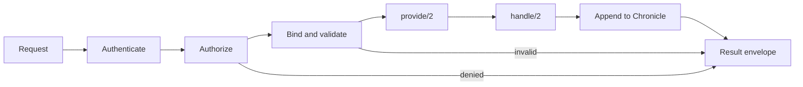

Arc for Elixir has one idea: you declare what your application does, and Arc runs it the same way wherever the request comes from. This page explains the pieces so that the rest of the documentation reads as consequences.

## Artifacts are modules

There are two kinds of artifact:

- A **command** (`use Arc.Command`) is a struct that describes a request and a `handle/2` that decides.
- A **read model** (`use Arc.ReadModel`) is a module of queries over one model struct.

Both are ordinary modules. `use` adds a `__arc__/0` function that returns a descriptor built at compile time: the fields, rules, authorization and queries you declared. Arc never inspects your source or uses reflection at runtime.

## Discovery and the application

`use Arc.Application, otp_app: :my_app` defines the runtime. When it starts (or when something first needs it), Arc scans the modules of `:my_app`, keeps the ones that define `__arc__/0`, and builds the route table. A duplicate route is a startup error that names both artifacts, not a surprise at request time.

The application is also a supervisor: it owns the processes behind [observable queries](queries.md#observable-queries). There is no global configuration; everything is scoped to the application module, so tests and several Arc applications in one VM stay isolated. See [Configuration](configuration.md).

## The context replaces dependency injection

Arc has no container. A handler calls `Repo`, a context module or `Chronicle` directly, and receives request-scoped facts in an `%Arc.Context{}`:

| Field | Meaning |
| --- | --- |
| `principal` | The caller, an `Arc.Principal` |
| `tenant` | The resolved tenant header value, or `nil` |
| `correlation_id` | Echoed on the response and attached to appended events |
| `provided` | Values returned by the command's `provide/2` |
| `chronicle` | Options for Chronicle calls, for example `client:` |
| `allowed_severity` | The highest validation severity the caller tolerates |

While an artifact runs, `arc_correlation_id` and `arc_tenant` are set as `Logger` metadata.

## The pipeline

Every command and query goes through the same steps, whether it arrives over HTTP, from LiveView, from a test, or from `Arc.execute/3`.

A step that fails ends the run and the result says which: not authorized (403), invalid (400), or an exception (500, with the detail redacted unless you opt in). Binding converts wire values to the declared types; a value of the wrong type is a `malformedRequest` validation result, not a crash.

## Routes come from module names

With the default `segments_to_skip: 1` and `route_prefix: "api"`:

| Module | Route |
| --- | --- |
| `MyApp.Authors.Registration.RegisterAuthor` | `POST /api/authors/registration/register-author` |
| `…Registration.RegisterAuthor`, validate only | `POST /api/authors/registration/register-author/validate` |
| query `all_authors` in `MyApp.Authors.Listing.Authors` | `GET /api/authors/listing/all-authors` |

The first segment is the application name and is skipped. The namespace after it also becomes the folder of the generated TypeScript and the slice location (module, feature, slice) used by the frontend.

## The wire format

Struct fields are `snake_case`; the wire and the generated TypeScript use `camelCase`. `Chronicle.Concept` values travel as the primitive they wrap. Dates and times are ISO 8601 strings. `nil` is `null`. The result envelopes are documented in the [Arc HTTP contract](/arc/http-contract/).

## Recording events

A command that changes state returns `{:append, event}`. Arc appends it to the event source named by the command's `key: true` field, with the principal as identity and the correlation id, then reports Chronicle's constraint and concurrency rejections as validation results. A command never records an event by calling Chronicle itself; returning it keeps the decision testable without a kernel. See [Commands](commands.md#what-handle-returns).

## Next steps

- [Commands](commands.md) and [Queries](queries.md) cover declarations in depth.
- [Hosting on Plug](hosting/plug.md) lists every route Arc serves.
